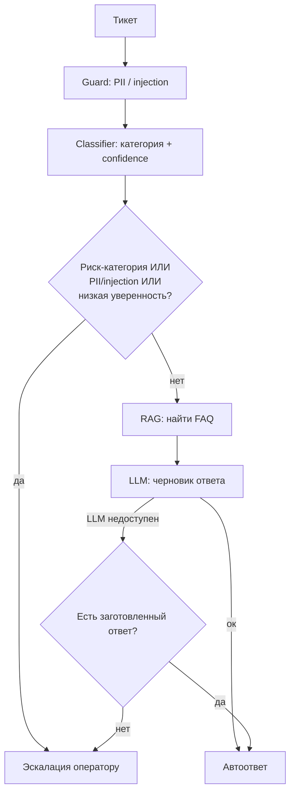

# Архитектура

## Компоненты
- **API** — принимает тикет, синхронно.
- **Guard** — ищет PII и prompt injection в тексте (регэкспы).
- **Classifier** — определяет категорию тикета и уверенность (TF-IDF + cosine similarity).
- **Router** — решает: автоответ или эскалация оператору.
- **RAG** — находит подходящий документ в базе знаний (FAQ).
- **LLM client** — генерирует текст ответа (в PoC — мок, без реального API).
- **Storage** — тикеты, лог решений, очередь эскалаций (в PoC — в памяти).

## Поток данных

## Sync vs async
- Приём + guard + classifier — быстрые, синхронные, без сети (ориентир ≤500мс).
- RAG + генерация ответа — могут быть медленными. В PoC вызываются синхронно для простоты; в проде это уйдёт в очередь, чтобы медленный LLM не тормозил приём тикетов.

## Хранилища
В PoC — просто списки/словари в памяти процесса: тикеты, лог решений, очередь на оператора, база FAQ. В проде: БД + отдельный неизменяемый лог решений (для аудита) + управляемая векторная база.

## Участие человека
Оператор всегда получает тикет вместо автоответа, если:
- категория денежная или про доступ/безопасность (`billing_refund`, `account_access`, `abuse_or_complaint`);
- классификатор не уверен;
- в тексте нашли PII или признак prompt injection;
- LLM недоступен и нет заготовленного ответа для категории.

## Что упрощено в PoC (и чем заменить в проде)
- Очередь на всплески нагрузки (10-20k тикетов/10 мин при сбоях) — не реализована, только описана.
- Хранилище — в памяти вместо БД.
- TF-IDF вместо embeddings + векторной базы.
- Дедупликация похожих тикетов при массовых сбоях — не реализована.
