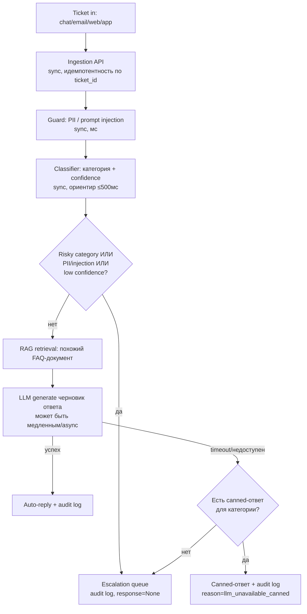

# Архитектура

## Компоненты

- **Ingestion API** (`app/main.py`) — принимает тикет с любого канала (chat/email/web/app), синхронно.
- **Guard** (`app/guard.py`) — PII- и prompt-injection-эвристики, регэкспы, мс.
- **Classifier** (`app/classifier.py`) — baseline-классификация категории + confidence, TF-IDF/cosine similarity.
- **Router** (`app/router.py`) — решение auto-reply vs escalate, идемпотентность, деградация при сбое LLM.
- **RAG retrieval** (`app/rag.py`) — поиск релевантного FAQ-документа.
- **LLM client** (`app/llm_client.py`) — генерация черновика ответа; в PoC — детерминированный мок.
- **Storage** (`app/storage.py`) — тикеты, audit log, escalation queue (в PoC — in-memory).

## Поток данных

## Sync vs async

- **Синхронный hot path**: приём тикета → guard → classifier → решение auto/escalate. Ориентир ≤500мс — весь путь дешёвый (regex + TF-IDF), без сетевых вызовов к внешним сервисам.
- **Медленная часть**: RAG retrieval + LLM generation — потенциально сотни мс — секунды. В PoC вызывается синхронно внутри того же запроса ради простоты; в целевой архитектуре classifier сразу возвращает клиенту `202 Accepted` + `ticket_id`, а генерация уходит в очередь и клиент получает ответ через вебхук/поллинг — так hot path не зависит от задержек LLM.
- Разделение fast/slow path — то, что позволяет держать SLA классификации при пиковой нагрузке 10-20k тикетов/10мин, даже если LLM API отвечает медленно или очередь генерации подросла.

## Хранилища

- **Ticket store** — состояние и результат по каждому тикету, ключ идемпотентности.
- **Audit log** — запись каждого автоматического решения (категория, confidence, path, флаги, причина) — обязательное требование аудируемости.
- **Escalation queue** — тикеты, ожидающие оператора.
- **Knowledge base (FAQ)** — источник для retrieval.

В PoC все четыре — `dict`/`list` в памяти процесса (`app/storage.py`, `data/faq/`). В проде: ticket store и audit log — отдельная БД (audit log — append-only, для комплаенса), knowledge base — managed vector DB, escalation queue — отдельная очередь/таблица с SLA-таймерами.

## Участие человека (human-in-the-loop) и запасные пути

- Риск-категории (`billing_refund`, `account_access`, `abuse_or_complaint`) — всегда эскалация, LLM не участвует в решении.
- Низкая уверенность классификатора (< порога, см. `docs/ml.md`) — эскалация вместо угадывания.
- Обнаруженный PII или признак prompt injection во входящем тексте — эскалация независимо от категории.
- Недоступность/timeout LLM API — не 500-им запрос: canned-ответ для покрытых категорий или эскалация с причиной `llm_unavailable`.
- Каждое из этих решений попадает в audit log с причиной — это и есть основа для последующего аудита автоматических решений.

## Под нагрузку и всплески (10-20k тикетов/10 мин при инцидентах)

Не реализовано в PoC, спроектировано:
- **Очередь** между ingestion API и обработкой — амортизирует всплеск, отвязывает приём (должен успевать всегда) от обработки (может отставать). PoC: синхронный вызов в одном процессе.
- **Автоскейлинг воркеров** classifier/RAG/LLM-генерации по глубине очереди.
- **Идемпотентность + retries без дублей** — уже заложена в PoC на уровне `ticket_id` (см. `app/router.py`), в проде — на уровне очереди (at-least-once delivery + дедуп по ключу).
- **Дедупликация/кластеризация похожих тикетов** во время инцидента (много тикетов про один и тот же сбой) — генерировать и проверять ответ один раз на кластер, а не на каждый тикет отдельно. Экономит и LLM-стоимость, и время оператора при ревью.
- **Circuit breaker** на вызов LLM API — при серии таймаутов переключаться на canned-ответы/эскалацию, не держать соединения и не множить задержку по всей очереди.
